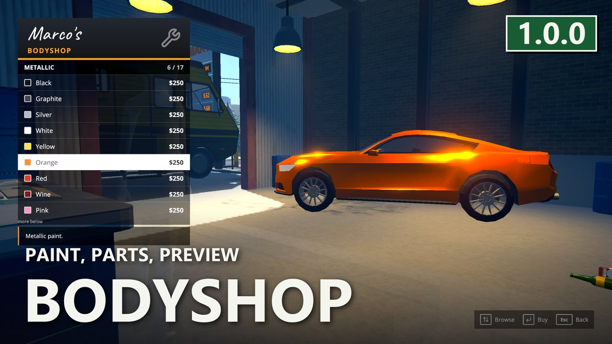
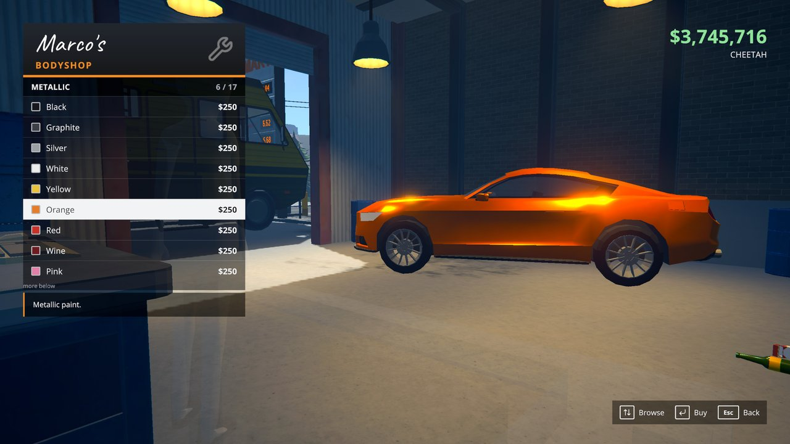
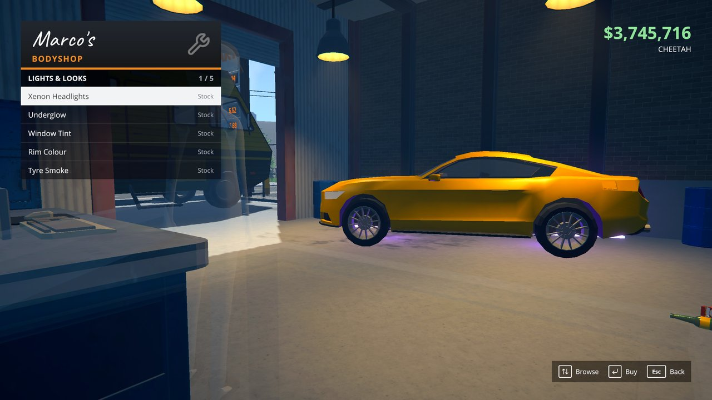
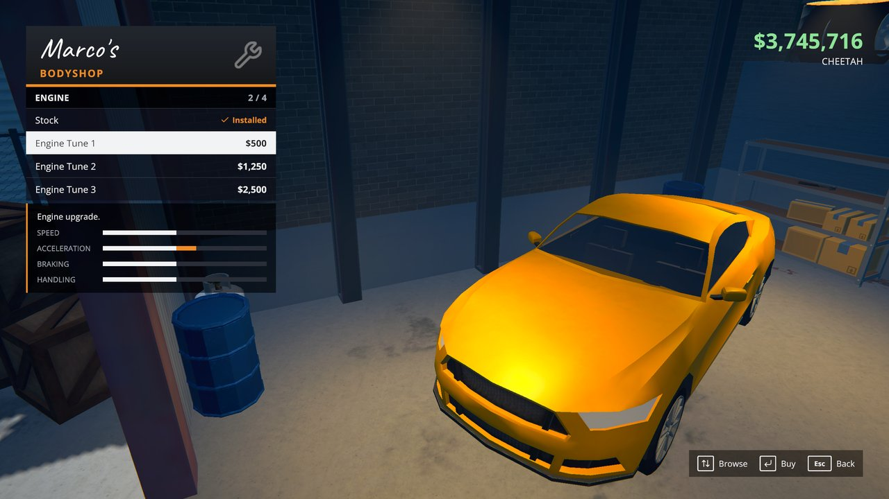
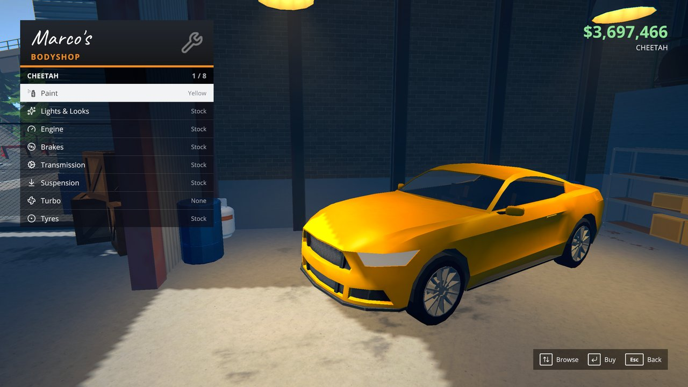
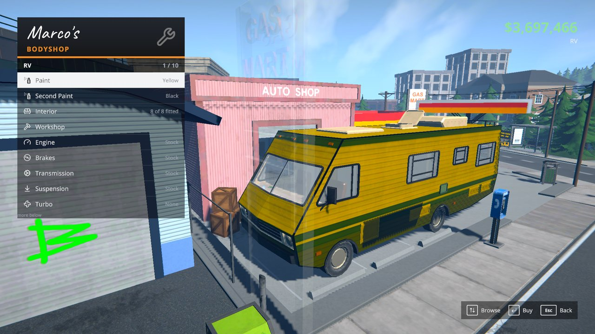
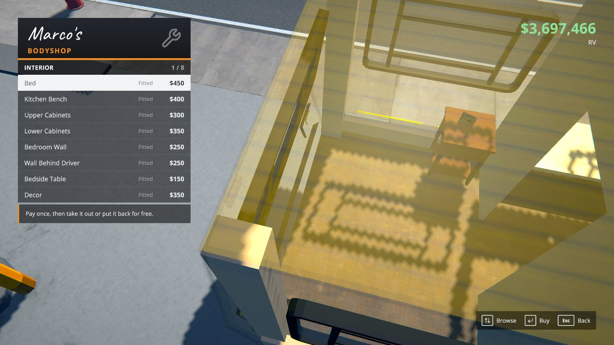

# Marco's Bodyshop - A Tuning Garage For Schedule I

> 🛟 **Need help or found a bug?** Get support at [support.doodesch.de/marcosbodyshop](https://support.doodesch.de/marcosbodyshop).

**Download:** [Nexus Mods](https://www.nexusmods.com/schedule1/mods/2987) · [Thunderstore](https://thunderstore.io/c/schedule-i/p/DooDesch/MarcosBodyshop/) · [GitHub Releases](https://github.com/DooDesch-Mods/ScheduleOne-MarcosBodyshop/releases)


[](https://mods.doodesch.de) [](https://polyfill.doomods.com/mod/marco-s-bodyshop)

[](https://mlvscan.com/attestations/att_SEn3DHk83N5zQ7-PcAe0HqKb)



> Marco does more than paint now.

## What it does

Park any car in Marco's shop at the gas station and pick **Pimp my ride** in his dialogue. A menu opens
over the car, the camera moves to the part you look at, and the car shows each choice before you pay.

- **Paint** - the game's colours, plus metallic, matte and chrome.
- **Second Paint** - the trim in its own colour, on vehicles whose model has one (the RV of RV Repair Van).
- **Lights & Looks** - xenon headlights, underglow (all around, sides only, or front and back), window tint,
  rim colour and tyre smoke, each in colours.
- **Horn** - two-tone horn, air horn, short beep, Euro fanfare, clown horn, rubber duck, freight train, fanfare, La Cucaracha and a bicycle horn. Hold G to honk.
- **Engine, Brakes, Transmission, Suspension, Steering, Weight** - two to four stages each, with bars for speed,
  acceleration, braking and handling.
- **Nitro** - hold Left Ctrl for a boost with a nitrous rush and blue flames at the exhaust. The stamina bar shows
  the tank, which refills by itself in 90 seconds.
- **Turbo**, and **Drift Tyres** or **Grip Tyres**.
- **Trunk** - three tiers with 5, 10 or 15 more trunk slots (up to 20), with spare tyres, a stack of boxes or a moving load strapped to the roof.

Parts are paid from your bank balance, like Marco's respray. Stock is always free. A part you replace is not
refunded.

A vehicle too big for the hall parks on the lot in front of it.

Browse with W/S or the arrow keys, buy with Space or Enter, or use the mouse. Escape goes back.

## Settings

Every price is in `UserData/MelonPreferences.cfg` under `[MarcosBodyshop]`, one `Price_<id>` line per item.
Nitro has `NitroKey`, `NitroBoost`, `NitroSeconds` and `NitroRechargeSeconds` there.

## Multiplayer

Everyone needs the mod. One player at a time uses Marco's garage. The buyer pays, and the host fits the part
on the car, so every player sees it.

## For mod authors

`MarcosBodyshop.Api.BodyshopApi` adds categories and entries to the menu, gates the built-in ones per vehicle,
and registers garages and bays of your own. RV Repair Van uses it for the RV's interior and workshop.

```csharp
BodyshopApi.RegisterCategory(new BodyshopCategory
{
    Id = "mymod.sirens", Label = "Sirens", Icon = "wrench", Order = 1000,
    Entries = v => MySirens.All.Select(s => new BodyshopEntry
    {
        Id = s.Id, Label = s.Name, Price = 200,
        Installed = car => MySirens.Fitted(car) == s.Id,
        Apply = car => MySirens.Fit(car, s.Id),   // runs on the host; null = done, text = refused
    }),
});
```

## Uninstalling

The tuning is saved by Chassis and stays on the cars without this mod.

## Screenshots

| | |
|---|---|
|  |  |
|  |  |
|  |  |

## Installation

### Recommended: Nexus Mods

1. Install **MelonLoader 0.7.3** or newer for Schedule I ([melonwiki.xyz](https://melonwiki.xyz/)).
2. Download Marco's Bodyshop from [Nexus Mods](https://www.nexusmods.com/schedule1/mods/2987) and install it with Vortex,
   or put **`MarcosBodyshop.dll`** into your Schedule I `Mods/` folder.
3. Get the mods under Requirements from their Nexus pages the same way.

### Thunderstore mod manager

Install from the [Thunderstore page](https://thunderstore.io/c/schedule-i/p/DooDesch/MarcosBodyshop/) with r2modman or Gale. The dependencies are pulled in automatically.

## Requirements

- [MelonLoader](https://melonwiki.xyz/) 0.7.3 or newer
- [S1API](https://thunderstore.io/c/schedule-i/p/ifBars/S1API_Forked/) 3.2.1 or newer
- [Chassis](https://www.nexusmods.com/schedule1/mods/2918) 1.8.0 or newer
- [Sideload](https://www.nexusmods.com/schedule1/mods/2360) 1.35.0 or newer

## Community

[](https://mods.doodesch.de)

Join the DooDesch Mods Discord: update pings, polls on what comes next, and playtests of new mods.

## Credits

Built by DooDesch on [S1API](https://github.com/ifBars/S1API) by ifBars.
Menu icons from [Lucide](https://lucide.dev), licensed [ISC](https://lucide.dev/license).
[THIRD-PARTY-NOTICES.md](THIRD-PARTY-NOTICES.md) has every part with its license text.

## License

DooDesch API License - build your own mods on `BodyshopApi`, do not copy the code. Forks, changes and pull
requests are welcome. Publishing or reuploading the mod or a changed copy needs written permission. See
[LICENSE.md](LICENSE.md).

This mod is written with help from generative AI tools (Anthropic Claude, OpenAI Codex).
